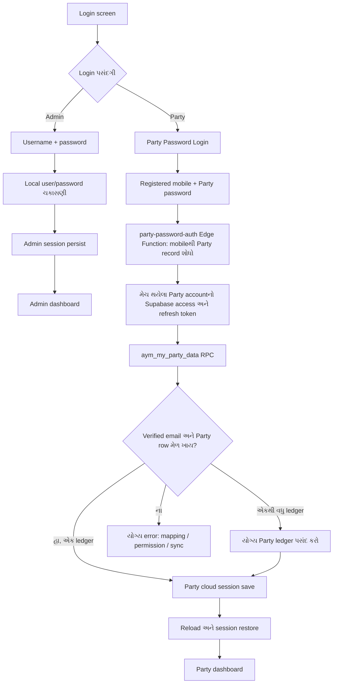
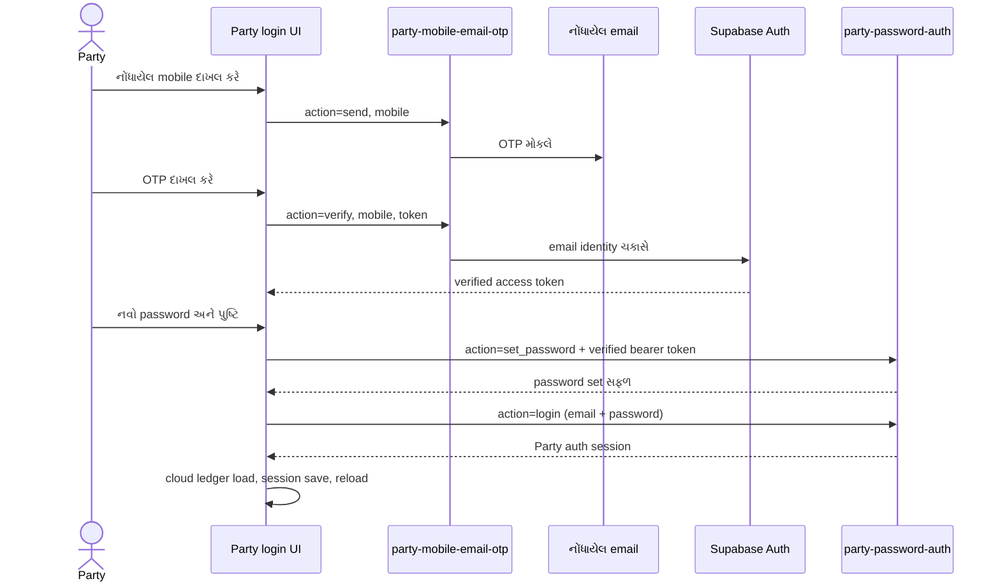
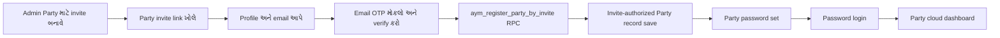

# Smart Ledger — Login Structure

આ દસ્તાવેજ હાલના Smart Ledger login code પ્રમાણે છે. તેમાં Admin login, Party email/password login, email OTPથી password set/reset, inviteથી નવું Party account અને login પછી session restoreનો flow દર્શાવ્યો છે.

## 1. Loginના પ્રકાર

| Login પ્રકાર | ઓળખ ચકાસવાની રીત | સફળ થયા પછી |
| --- | --- | --- |
| Admin | Admin username અને password; server-enabled setup હોય તો Supabase-backed Admin session પણ બનાવે છે | Admin role સાથે app dashboard |
| Party password | Partyનો નોંધાયેલ mobile અને Party password; Supabase Edge Function mobileથી account શોધીને credentials ચકાસે છે | Party માટેનો પોતાનો cloud ledger load થાય છે |
| Party OTP | નોંધાયેલ mobile પર lookup; OTP તેના રેકોર્ડના email પર મોકલાય અને verify થાય | Password set/reset માટે verified session |
| Invite registration | Admin invitation link અને email OTP | Party record બને, પછી Party password set થાય |
| Email Cloud access | Verified emailથી Party cloud row ઓળખાય | Read-only Party view |

Party password Admin passwordથી અલગ છે. OTP સામાન્ય password loginનો વિકલ્પ નથી; તે password બનાવવા/ફરી સેટ કરવા માટે છે. Partyનું રોજનું login એક જ screen પર નોંધાયેલ mobile અને Party passwordથી થાય છે.

## 2. મુખ્ય login flow



## 3. OTPથી password set અથવા reset



## 4. Inviteથી નવું Party account



## 5. Session અને role

- સામાન્ય app role sessionમાં `userId`, `username`, `name`, `role`, `partyId` અને login સમય રહે છે; app તેને persist કરીને dashboard શરૂ કરે છે.
- Party cloud auth token `aym_phone_auth_v1`માં રાખવામાં આવે છે. તેમાં access/refresh token, verified email, Supabase URL/key અને `portal` ઓળખ હોય છે.
- App ફરી ખૂલે ત્યારે `site/party-mobile-email-login.js` saved Party session શોધે છે અને `restorePartyCloud()` ચલાવે છે.
- Restore વખતે cloud dataમાંથી Party profile, entries, loan forms, modules વગેરે load થાય છે. Party record `partyId` સાથે મેળ ખાતો હોવો જોઈએ; Party sessionમાં Admin cache merge થતો નથી.
- Role અને permission પ્રમાણે menu/actions દેખાય છે. Party અને Viewer માટે ઉપલબ્ધ કાર્યોમાં loan form અને Available Guarantors જેવા views આવે છે; કેટલાક read-only cloud entry paths પર કેટલીક ક્રિયાઓ છુપાય છે.
- Sign out વખતે Party auth token સાફ થાય છે; શક્ય હોય તો Supabase Auth logout પણ મોકલાય છે.

## 6. સંબંધિત code

| કામ | File / symbol |
| --- | --- |
| Admin credential check અને સામાન્ય app session | [`site/index.html`](./site/index.html) — `LedgerFeatures.identity.doLogin` |
| Party password login, OTP set/reset UI અને startup restore hook | [`site/party-mobile-email-login.js`](./site/party-mobile-email-login.js) |
| OTP verify, Party cloud identity adoption અને invite RPC calls | [`site/index.html`](./site/index.html) — `verifyPhoneLoginOtp`, `finishPartyCloudLogin`, `adoptPartyCloud`, `AYMPO` |
| Party cloud row fetch અને session restoration | [`site/party-cloud.js`](./site/party-cloud.js) |
| Server-side password login અને set-password actions | Supabase Edge Function `party-password-auth` |
| Mobile lookup અને email OTP issue/verify | Supabase Edge Function `party-mobile-email-otp` |
| Invite authorization અને Party record creation | `supabase/migrations/202611140002_party_invite_self_registration.sql` |

## 7. સરળ રીતે સમજવું

```text
Admin: username/password → Admin role → Admin dashboard

નવું Party: invite → email OTP → Party record → password set → mobile + password login

પહેલેથી નોંધાયેલ Party: mobile + password → Supabase auth → પોતાનો ledger → Party dashboard

Password ભૂલાયો: registered mobile → email OTP → verify → નવો password → ફરી login
```
